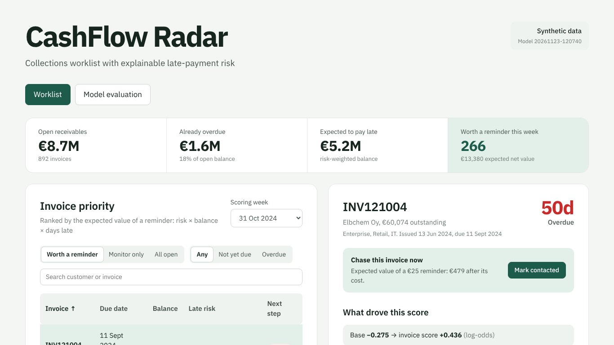
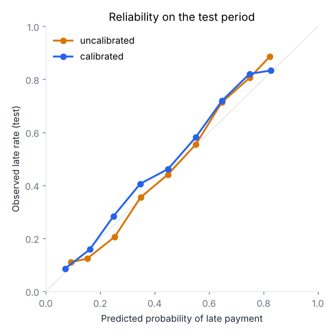
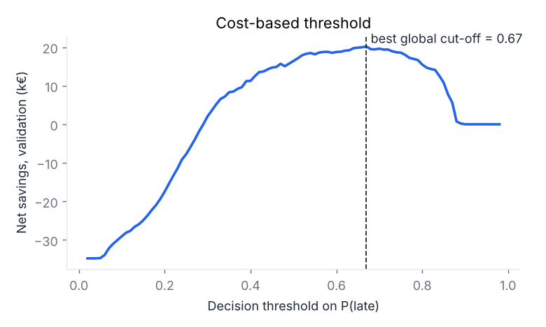
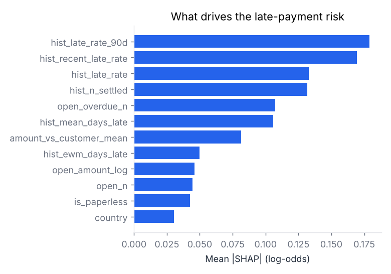

# CashFlow Radar

**Predicts which B2B invoices will be paid late, explains why, and ranks the collections worklist by the expected value of a reminder.**

**[Live demo](https://verdant-wisp-2d96e9.netlify.app)**: runs in the browser, nothing to install.



## Results

All figures come from a held-out future period the model never saw.

| | Customer's past late rate | XGBoost (calibrated) |
|---|---|---|
| ROC-AUC | 0.706 | **0.751** |
| Expected days late, MAE | 7.30 | **6.65** |

- **18% lower average overdue balance** than working the list alphabetically (€1.57M → €1.28M), and **1.4 days lower DSO**.
- **2× the net savings** of a single probability cut-off: an invoice gets a reminder only when *P(late) × benefit > cost*.

<p>
  
</p>

## What makes it hard

- **No leakage:** features only use invoices *settled* before the scoring date, and a test checks this.
- **Time-aware validation:** chronological split; labels not yet known at the cut-off are purged.
- **Calibration:** chosen out-of-time, because the decision compares a probability to a cost ratio.
- **Explainable:** every score comes with SHAP reasons, like *"Paid 82% of the last 10 invoices late"*.

## Run it

```bash
pip install -e ".[dev]"
python -m cashflow_radar.train     # train + evaluate, logs to MLflow
python -m cashflow_radar.score     # build the worklist
uvicorn cashflow_radar.api.main:app --port 8000
cd frontend && npm install && npm run dev   # http://localhost:5173
```

Or run everything in Docker with `docker compose up --build`, then open http://localhost:8080.

## Stack

Python · Pandas · scikit-learn · XGBoost · SHAP · Optuna · MLflow · FastAPI · PostgreSQL · React · TypeScript · Docker · GitHub Actions

## Data

[IBM accounts-receivable sample](https://github.com/bcBusinessStats/data1135) (2,466 invoices) and a synthetic book of 28k invoices with realistic payment patterns. The cost assumptions, such as a €25 reminder that removes 35% of the lateness, are in `config/config.yaml`.
